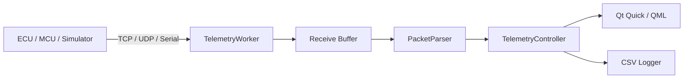

# AXIOM Automotive Telemetry Workbench

A modern C++17 / Qt 6 engineering workbench for real-time automotive-style telemetry acquisition, trace inspection, diagnostics, logging, transport testing, and automated verification.

[](https://github.com/amirhqi/axiom-automotive-telemetry/actions/workflows/ci.yml)
[](https://github.com/amirhqi/axiom-automotive-telemetry/releases)


## Product Preview

### Live Monitor


### Trace


### Diagnostics


## What is AXIOM?

AXIOM is a desktop telemetry and diagnostics application designed around the same engineering concerns that appear in hardware-facing and automotive software:

- reliable asynchronous I/O
- clear separation of transport, parsing, state, and presentation
- non-blocking UI architecture
- malformed-frame handling
- reconnect behavior
- observability through live data, trace, and diagnostics
- reproducible automated tests

The name **AXIOM** reflects the idea of turning raw signals into trusted engineering information:

**Acquire -> Validate -> Observe -> Diagnose**

## Core Features

- C++17
- Qt 6 / Qt Quick / QML
- TCP transport
- UDP transport
- Serial transport
- dedicated worker-thread I/O
- TCP fragmentation-safe receive buffering
- frame validation and rejection counters
- automatic reconnect with backoff
- Live Monitor workspace
- Trace workspace
- Diagnostics workspace
- CSV session logging
- fault-injection simulator
- unit tests
- TCP integration tests
- UDP integration tests
- functional smoke tests
- CMake / Ninja workflow
- Embedded Linux / ARM64 / Yocto scaffolding

## Architecture



The GUI remains on the Qt main thread. I/O and connection lifecycle are handled through a dedicated worker-thread design so slow or bursty transport activity does not block the user interface.

See [Architecture](docs/ARCHITECTURE.md).

## Validation

The current Windows development build has passed:

```text
PacketParserTests       PASSED
TcpIntegrationTests     PASSED
UdpIntegrationTests     PASSED
CsvLoggerTests          PASSED
FunctionalSmokeTests    PASSED

5/5 automated test targets passed
```

## Download for Windows

### Recommended: Installer

Download:

**AXIOM-v2.6.1-Windows-x64-Setup.exe**

Install it normally and launch AXIOM from the Start menu.

### Portable

Download:

**AXIOM-v2.6.1-Windows-x64-Portable.zip**

Extract the complete archive and run:

```text
AxiomTelemetryWorkbench.exe
```

Qt Creator and the Qt SDK are not required for either Windows package.

[Download the latest release](https://github.com/amirhqi/axiom-automotive-telemetry/releases/latest)

## Quick Demo

Start the simulator:

```bash
python tools/simulator.py
```

Then connect AXIOM using:

```text
Transport: TCP
Host:      127.0.0.1
Port:      5000
```

Fault scenarios:

```bash
python tools/simulator.py --fault-rate 0.15
python tools/simulator.py --split-rate 0.8
python tools/simulator.py --disconnect-every 5
python tools/simulator.py --rate 500 --fault-rate 0.02
```

## Build from Source

```bash
cmake -S . -B build -DCMAKE_BUILD_TYPE=Debug -DBUILD_TESTING=ON
cmake --build build --parallel
ctest --test-dir build --output-on-failure
```

## Repository Layout

```text
.github/          CI and repository templates
assets/           branding assets
benchmarks/       benchmark code
cmake/            CMake toolchains
docs/             technical documentation and screenshots
qml/              Qt Quick UI
scripts/          build/test helpers
src/              C++ source
tests/            automated tests
tools/            simulators and utilities
yocto/            Embedded Linux / Yocto scaffold
```

## Documentation

- [Architecture](docs/ARCHITECTURE.md)
- [Design Decisions](docs/DESIGN_DECISIONS.md)
- [Protocol](docs/PROTOCOL.md)
- [Building](docs/BUILDING.md)
- [Testing](docs/TESTING.md)
- [Distribution](docs/DISTRIBUTION.md)
- [Roadmap](docs/ROADMAP.md)
- [Contributing](CONTRIBUTING.md)
- [Security](SECURITY.md)
- [Changelog](CHANGELOG.md)

## Scope

AXIOM is an engineering portfolio project and experimental telemetry platform.

It is **not** a safety-certified ECU, ISO 26262 component, or certified production-vehicle diagnostic product.

## Author

Designed and developed by **Amirhossein Haghi**.

## License

See [LICENSE](LICENSE).