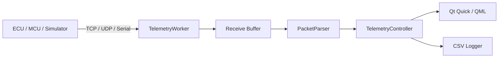

# AXIOM Automotive Telemetry Workbench

**Real-time telemetry acquisition, trace inspection, diagnostics, logging, and transport testing in C++17 / Qt 6.**

[](https://github.com/amirhqi/axiom-automotive-telemetry/actions/workflows/ci.yml)
[](https://github.com/amirhqi/axiom-automotive-telemetry/releases/latest)


## Preview

### Live Monitor


### Trace


### Diagnostics


## Overview

AXIOM is an engineering telemetry workbench designed around the same problems found in hardware-facing and automotive applications: asynchronous I/O, stream framing, validation, reconnect behavior, logging, diagnostics, responsive UI design, and automated verification.

**Acquire -> Validate -> Observe -> Diagnose**

### Core capabilities

- C++17 backend
- Qt 6 / Qt Quick / QML UI
- TCP, UDP, and Serial transports
- worker-thread I/O architecture
- TCP fragmentation-safe receive buffering
- packet/frame validation and rejection counters
- reconnect handling
- live telemetry visualization
- raw frame trace
- diagnostics and session statistics
- CSV logging
- deterministic fault-injection simulator
- unit, integration, and functional smoke tests
- CMake/Ninja build workflow
- Embedded Linux, ARM64, and Yocto scaffolding

## Architecture



The Qt GUI stays on the main thread while transport and connection work are handled separately, helping keep rendering and interaction responsive during I/O activity.

See [Architecture](docs/ARCHITECTURE.md) and [Design Decisions](docs/DESIGN_DECISIONS.md).

## Download

### Windows Installer — recommended

Download **AXIOM-v2.6.1-Windows-x64-Setup.exe** from the [latest release](https://github.com/amirhqi/axiom-automotive-telemetry/releases/latest).

Install it normally and launch AXIOM from the Start menu.

### Windows Portable

Download **AXIOM-v2.6.1-Windows-x64-Portable.zip**, extract the entire archive, then run:

```text
AxiomTelemetryWorkbench.exe
```

Qt Creator and the Qt SDK are **not required** to run either binary package.

## Quick Demo

Run:

```bash
python tools/simulator.py
```

Then connect with:

```text
Transport: TCP
Host:      127.0.0.1
Port:      5000
```

Fault scenarios:

```bash
python tools/simulator.py --fault-rate 0.15
python tools/simulator.py --split-rate 0.8
python tools/simulator.py --disconnect-every 5
python tools/simulator.py --rate 500 --fault-rate 0.02
```

## Tests

The project includes:

- `PacketParserTests`
- `TcpIntegrationTests`
- `UdpIntegrationTests`
- `CsvLoggerTests`
- `FunctionalSmokeTests`

Latest validated local Windows run: **5/5 test targets passed.**

Run them with:

```bash
ctest --test-dir build --output-on-failure
```

## Build from Source

Requirements:

- Qt 6.11.x
- C++17 compiler
- CMake
- Ninja or another supported CMake generator

```bash
cmake -S . -B build -DCMAKE_BUILD_TYPE=Debug -DBUILD_TESTING=ON
cmake --build build --parallel
ctest --test-dir build --output-on-failure
```

See [Building](docs/BUILDING.md).

## Repository Structure

```text
.github/        CI and repository templates
assets/         application branding assets
benchmarks/     benchmark code
cmake/          toolchain files
docs/           architecture, build, testing, protocol and screenshots
qml/            Qt Quick UI
scripts/        build/test helpers
src/            C++ application source
tests/          automated tests
tools/          simulators and utilities
yocto/          Embedded Linux / Yocto scaffold
```

## Documentation

- [Architecture](docs/ARCHITECTURE.md)
- [Design decisions](docs/DESIGN_DECISIONS.md)
- [Protocol](docs/PROTOCOL.md)
- [Building](docs/BUILDING.md)
- [Testing](docs/TESTING.md)
- [Distribution](docs/DISTRIBUTION.md)
- [Embedded Linux](docs/EMBEDDED_LINUX.md)
- [Roadmap](docs/ROADMAP.md)
- [Contributing](CONTRIBUTING.md)
- [Security](SECURITY.md)
- [Changelog](CHANGELOG.md)

## Project Scope

AXIOM is an engineering portfolio and experimental telemetry project. It is **not** a safety-certified ECU, ISO 26262 component, or certified production-vehicle diagnostic tool.

## Author

**Amirhossein Haghi**

## License

See [LICENSE](LICENSE).