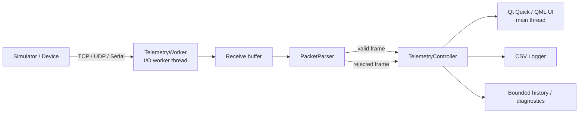

# AXIOM Automotive Telemetry Workbench

[](https://github.com/amirhqi/axiom-automotive-telemetry/actions/workflows/ci.yml)


AXIOM is a desktop engineering workbench for acquiring, validating, visualizing and diagnosing automotive-style telemetry streams. The project is designed around a responsive Qt/QML front end and a C++ backend with a dedicated I/O worker thread, explicit packet parsing, bounded histories, session logging and automated tests.

> **Project status:** Engineering portfolio project / prototype. It is not intended for safety-critical vehicle use.

## Why AXIOM

The name *Axiom* reflects the goal of turning raw machine signals into trusted engineering information: acquisition -> validation -> observation -> diagnosis. The application intentionally uses a workstation-style interface rather than a consumer dashboard, with separate live monitoring, trace and diagnostics workflows.

## Highlights

- C++17 backend with Qt 6 / QML UI
- Dedicated worker-thread architecture for I/O so the GUI event loop remains responsive
- TCP, UDP and serial transport support
- Buffered TCP framing that handles split network reads correctly
- Packet parsing and range validation with accepted/rejected frame accounting
- Automatic reconnect behavior for stream transports
- Live telemetry for engine speed, vehicle speed, coolant temperature and battery voltage
- Raw frame trace and event/error log
- Bounded in-memory history for predictable memory use
- CSV session logging for offline analysis
- Fault-injection / telemetry simulator in Python
- Unit, integration and functional smoke tests
- CMake-based build and GitHub Actions CI
- ARM64 cross-compilation and Yocto material are included as development scaffolding; they are not presented as production deployment validation

## Architecture



The GUI stays on Qt's main thread. Transport work runs in a dedicated worker thread and communicates with the controller through Qt signals/slots. See [Architecture](docs/ARCHITECTURE.md) for design decisions and threading details.


## Telemetry frame

The current simulator uses a line-oriented application frame such as:

```text
RPM=2240,SPEED=56,TEMP=91.7,BATTERY=13.85
```

The text protocol is intentionally simple so transport behavior, validation, threading, recovery and testing remain easy to inspect. Automotive CAN/DBC support is tracked separately in the roadmap.

## Repository layout

```text
.
|-- src/                 C++ backend
|-- qml/                 Qt Quick/QML UI
|-- tests/               unit, integration and functional tests
|-- tools/               Python telemetry/fault simulator
|-- scripts/             build/test helper scripts
|-- benchmarks/          stress/benchmark utilities
|-- cmake/               toolchain/build support
|-- yocto/               Yocto/BitBake application packaging scaffold
|-- docs/                architecture, testing and development notes
|-- .github/             CI, issue forms and contribution templates
`-- CMakeLists.txt
```

## Requirements

### Windows development host

- Windows 11
- Qt 6.11.x with MinGW-w64 13.1
- CMake 3.22+
- Ninja (recommended)
- Python 3 for the simulator

Qt 6.11 officially supports Windows 11 x86_64 with MinGW-w64 13.1.

### Linux development host

The application is intended to remain portable to Linux/Embedded Linux. A native Linux build should be validated before claiming Linux deployment support for a release.

## Build

### Qt Creator

Open `CMakeLists.txt`, select a Qt 6.11 desktop kit, configure and build.

### Command line

```powershell
cmake -S . -B build -G Ninja -DCMAKE_BUILD_TYPE=Debug
cmake --build build --parallel
ctest --test-dir build --output-on-failure
```

## Run the simulator

Start the TCP simulator from the repository root:

```powershell
python .\tools\simulator.py
```

Then connect AXIOM to:

```text
Transport: TCP
Host:      127.0.0.1
Port:      5000
```

### Fault injection

Malformed application frames:

```powershell
python .\tools\simulator.py --fault-rate 0.05
```

Aggressive TCP fragmentation:

```powershell
python .\tools\simulator.py --split-rate 0.8
```

Periodic disconnects for reconnect testing:

```powershell
python .\tools\simulator.py --disconnect-every 10
```

Higher-rate traffic:

```powershell
python .\tools\simulator.py --rate 500 --fault-rate 0.02
```

## Testing

Validated locally on Windows 11 with Qt 6.11.1 / MinGW-w64 13.1. Automated test suite: 5/5 passing.

The test suite covers:

1. Packet parser behavior and validation
2. TCP integration, including frames split across multiple reads
3. UDP datagram integration
4. CSV logger behavior
5. End-to-end functional smoke behavior

For details, see [Testing](docs/TESTING.md).

## Engineering principles

- Keep UI and I/O responsibilities separated
- Prefer explicit ownership and predictable object lifetime
- Keep blocking/network work off the GUI thread
- Bound long-lived buffers and histories
- Validate external data before presenting it to the UI
- Test transport boundaries, not only pure parsing logic
- Keep platform-specific deployment claims separate from portable source-code support

## Embedded Linux direction

The repository contains early ARM64/Yocto scaffolding to document the intended deployment path. It does **not** claim that the current version has been production-validated on an embedded target. Planned work includes native Linux validation, ARM64 deployment, SocketCAN, DBC decoding and ISO-TP/OBD-II support.

See [Roadmap](docs/ROADMAP.md).

## Contributing

See [CONTRIBUTING.md](CONTRIBUTING.md). Bug reports and feature proposals can use the repository issue forms.

## Security

This project is not safety-certified and must not be used as a safety-critical automotive component. Please report security issues according to [SECURITY.md](SECURITY.md).

## License

MIT License. See [LICENSE](LICENSE).

---

Maintained by [@amirhqi](https://github.com/amirhqi).