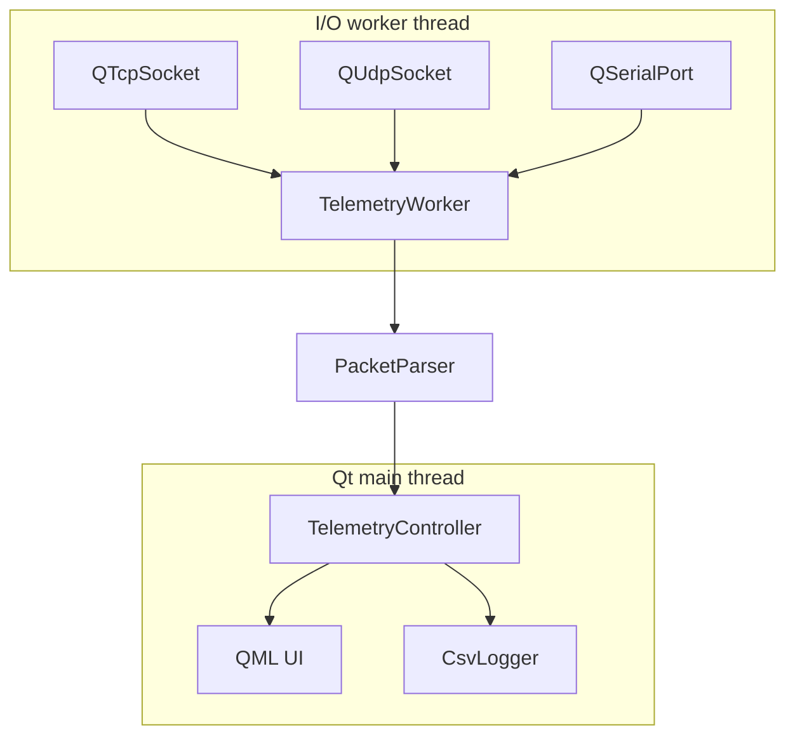

# Architecture

## Goals

AXIOM separates transport I/O, packet interpretation, application state and presentation so each layer can be tested and changed independently.

## Runtime model

The UI is only updated from the main thread. The worker thread handles transport events and emits data/events back through Qt's queued signal/slot mechanism.

## Main components

### TelemetryWorker
Owns transport-facing I/O behavior and reconnect logic. It must not manipulate QML items directly.

### PacketParser
Converts external frame text into validated application data. Keeping parsing separate from sockets makes parser tests deterministic and transport-independent.

### TelemetryController
Owns presentation-facing application state, counters, bounded history and high-level session behavior.

### CsvLogger
Persists validated telemetry frames for offline inspection without mixing persistence concerns into the parser.

## Design decisions

### Dedicated I/O worker thread
Network and serial activity should not compromise UI responsiveness. The project therefore keeps transport work outside the GUI thread.

### Buffered TCP parsing
TCP is a byte stream, not a message protocol. One application frame may arrive across multiple reads, and one read may contain multiple frames. The receive buffer is responsible for reconstructing complete line-delimited application frames before parsing.

### UDP treated as datagrams
UDP preserves datagram boundaries. Each datagram can therefore be validated independently rather than accumulated as a TCP-style byte stream.

### Bounded history
Live tools can run for long sessions. In-memory frame/chart histories are bounded to avoid unbounded memory growth.

### Explicit recovery state
Reconnect behavior is visible in counters and event logging, making recovery observable rather than hidden.

## Current boundary

The current application protocol is a development telemetry format, not a production vehicle bus protocol. CAN/DBC/ISO-TP integration belongs in a later automotive transport layer rather than being mixed into the existing parser without a clear abstraction boundary.